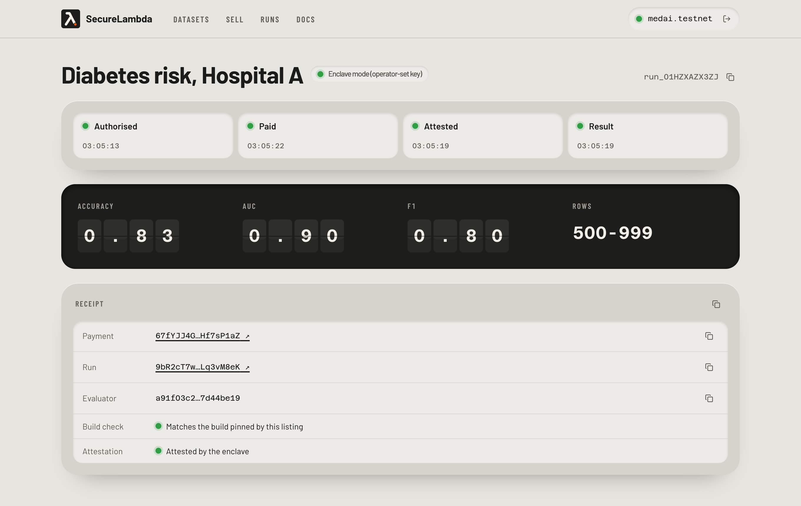
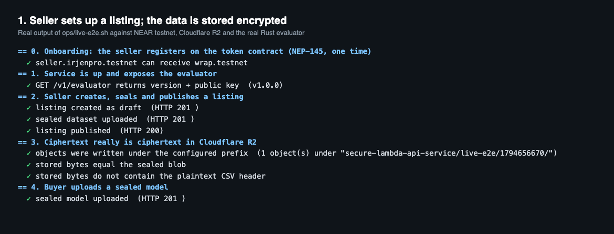
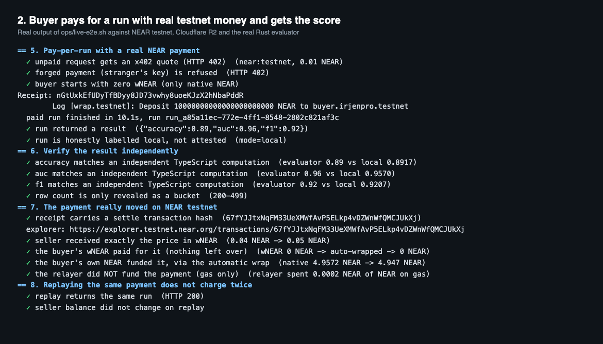

# SecureLambda

### Test a model on data you never see.

**Private data stays sealed. Private models stay sealed. The score is what leaves.**

SecureLambda is a pay-per-run evaluation service for data owners and model builders. A hospital can keep patient records; an AI team can keep its model. SecureLambda brings the two together for a bounded evaluation, then returns rounded metrics instead of either party’s files.

**Try the dashboard preview:** [secure-lambda402.vercel.app](https://secure-lambda402.vercel.app/) · **See the proof:** [a paid run in an OutLayer enclave](docs/pr-evidence/outlayer-enclave-run.md) · **Read the integration guide:** [docs/api/integration-guide.md](docs/api/integration-guide.md)

**Enclave run on NEAR testnet:** `accuracy 0.85` · `AUC 0.93` · `F1 0.75` · evaluated in OutLayer, seller paid on-chain. [Execution](https://testnet.nearblocks.io/txns/2xfjVzdvSchKEoPVLnLdttfoSNxxe34Ggf3SGkpUbApf) · [settlement](https://testnet.nearblocks.io/txns/DpXfGrYssCapGHDjjSbxN7uF3PDET6Wiu1X69BPHPyYY) · [run record](docs/pr-evidence/outlayer-enclave-run.md).

> Think of it as a blind date for a model and a dataset: they meet inside a TEE, neither gets the other’s number, and the evaluator sends home three scores.


## The product in one run

1. A **seller** creates a dataset listing and encrypts the dataset in their browser before upload.
2. A **buyer** encrypts and uploads a logistic-regression model for that listing.
3. The buyer or an AI agent requests a run. SecureLambda returns an x402 quote; the buyer signs the quoted payment.
4. The evaluator scores the sealed files. A successful run returns rounded `accuracy`, `auc`, `f1` and a coarse row-count bucket.
5. The signed payment is settled to the seller only after success. Failed runs are not charged.

The intended privacy boundary is simple: the platform stores encrypted assets; the evaluator opens them to compute the score. The deployment mode matters, though—see [what is live and what is a prototype](#what-is-live-and-what-is-a-prototype) before treating a run as enclave-protected.

## What the screenshots prove

The public dashboard is connected to the live testnet API; its [5-minute guide](https://secure-lambda402.vercel.app/docs#test-it-in-5-minutes) walks through a run with a sample model.

**The dashboard, screen by screen.** The [screenshot walkthrough](screenshots/README.md) covers both sides of the marketplace: a buyer checking a model on their device, paying and getting an attested receipt, and a seller encrypting and publishing a dataset. Those captures use the dashboard's mock mode, so their names and scores are demo fixtures.



The two screenshots below are captured outputs from the end-to-end test workflow, showing the backend and payment path.

**1. Seller publishes a listing; the stored object is ciphertext.**



**2. Buyer pays on NEAR testnet, gets a score, and the seller receives the payment.** The evaluator in this run was deliberately labelled `local`, not attested.



The recorded run returned `accuracy 0.89`, `AUC 0.96`, and `F1 0.92`; the settlement transaction is [visible on NEAR testnet](https://testnet.nearblocks.io/txns/67fYJJtxNqFM33UeXMWfAvP5ELkp4vDZWnWfQMCJUkXj). The run was independently recomputed and the payment replay check did not charge twice. Full output: [`docs/pr-evidence/live-e2e-output.txt`](docs/pr-evidence/live-e2e-output.txt).

## NEAR and OutLayer: contracts and responsibilities

SecureLambda uses NEAR for identity and payment coordination. OutLayer is the execution environment for the optional TEE evaluator path. They are separate integrations with separate contracts.

| Integration | Contract / standard | What SecureLambda uses it for |
|---|---|---|
| NEAR login | NEP-413 signed message | Prove control of an account without a transaction or gas fee. The API issues a short-lived bearer session; identity is not accepted from an `x-account-id` header. |
| NEAR payment | NEP-366 delegate action + NEP-141 `ft_transfer` | The buyer signs permission to transfer the quoted amount of wNEAR to the seller. The service verifies it first and submits it only after a successful run. The relayer pays gas; the buyer’s token balance funds the payment. |
| wNEAR on testnet | `wrap.testnet` | NEP-141 token used for the testnet payment path. A seller must register on the token contract once with NEP-145 `storage_deposit`. The buyer can wrap native testnet NEAR into wNEAR. |
| OutLayer on testnet | `outlayer.testnet`, `request_execution` | The worker submits the evaluator input, project reference, secrets reference and resource limits as a NEAR function call, then polls the transaction. It reads the result and OutLayer’s `execution_completed` event, and checks the executed WASM hash against the listing before settlement. |

### Payment contract

The HTTP flow follows x402’s `402 → sign → retry` pattern:

```text
POST /v1/listings/:id/evaluate  →  402 quote (price, seller, wNEAR contract, nonce, expiry)
Buyer signs NEP-366 delegate action locally; no payment is broadcast yet
POST /v1/listings/:id/evaluate + X-Payment  →  verify → queue evaluation
Successful result + matching evaluator hash  →  relayer submits delegate → seller receives wNEAR
```

The delegate calls `ft_transfer` on the configured NEP-141 contract. This is why the payment is in a token: a native NEAR transfer inside a delegate would charge the relayer for the transfer amount. The buyer’s token balance is debited instead; the relayer pays only transaction gas. On the current testnet configuration, the token is `wrap.testnet`. Sepolia USDC is not supported.

### OutLayer execution contract

With `EVALUATOR_MODE=outlayer`, the worker calls `request_execution` on `outlayer.testnet`, using a dedicated signer account and a deployed project such as `owner/name`. The project secret holds the evaluator private key. The worker persists the transaction hash before polling; a pending response is not treated as a failed run. A missing or mismatched executed WASM hash blocks settlement.

OutLayer deployment setup, required environment values, resource limits, and key-handling details are in [`ops/runbook.md`](ops/runbook.md#configure-outlayer-deployment). The current request path passes input in the transaction and is subject to NEAR’s transaction-size limit; larger inputs need a state-based OutLayer input path.

## What is live and what is a prototype

This repo contains a working dashboard, API, worker, evaluator, and agent SDK. The public dashboard is available at the link above. The backend can be configured for real NEAR testnet payments and for OutLayer execution, but the committed local workflow defaults to mock evaluation and sandbox payments.

| Capability | Status in this repo |
|---|---|
| Dashboard | Deployed at Vercel against the live testnet API. `dev:mock` runs it locally against MSW mocks. |
| API, worker, encryption, scoring | Implemented; 345 tests pass (304 TypeScript, 41 Rust). TypeScript and Rust encryption are checked against shared vectors. |
| NEAR payment | A real paid testnet run is captured in `docs/pr-evidence`; x402 quote, forged-payment rejection, settlement, and replay behavior are exercised. |
| OutLayer TEE | Live on the testnet API: a paid run executed in OutLayer and settled is [recorded here](docs/pr-evidence/outlayer-enclave-run.md). The [screenshots](#what-the-screenshots-prove) and E2E capture use the **local** Rust evaluator. |
| Attestation | The worker checks OutLayer’s reported WASM hash against the pinned listing version. This service does not independently verify the Intel TDX quote. A matching WASM hash is not a complete proof of hardware attestation. |
| Key custody | Tier 1: the operator generates the evaluator key and is trusted to destroy the local copy. In-enclave key generation (Tier 2) is not implemented. |
| Models / network | Logistic regression JSON only. Current payment and OutLayer examples use NEAR testnet; NEAR mainnet and EVM USDC are not wired. |

No “100% private” claim: the operator-set key and attestation-verification limits are part of the trust model. A local evaluator run is useful for development and end-to-end payment tests, but it is not a TEE run.

## Business model and roadmap

**Who pays.** The model builder pays per run. The seller sets the price on the listing, in wNEAR; the full amount settles to the seller only after a successful run, and failed runs cost nothing. SecureLambda plans to take a 1% platform fee on each settled run; it is not charged yet.

**Roadmap**, in the order that closes the trust gaps above:

1. Tier 2 key custody: generate the evaluator key inside the enclave, so no operator ever holds it.
2. Verify the Intel TDX quote in the service, not only the WASM hash OutLayer reports.
3. State-based OutLayer input, so datasets larger than a NEAR transaction can be evaluated.
4. Model formats beyond logistic-regression JSON.
5. NEAR mainnet payments.

## Run locally

**Fastest check:** `npm install && npm run demo` runs one paid evaluation end to end on this machine, with no NEAR account: client-side encryption, the x402 quote, a signed payment, the real Rust evaluator and settlement on a local sandbox ledger. It needs Docker and Rust and prints `ALL 22 CHECKS PASSED`. See [`AGENTS.md`](AGENTS.md) for what each check proves.

To run the services yourself: Node.js 20+, npm, Docker, and Rust only if you want to run the Rust evaluator.

```bash
npm install
docker compose up -d postgres redis minio
cp ops/.env.example .env && set -a && . ./.env && set +a   # keep this shell for the steps below
npm run build --workspace=@securelambda/db
npm run prisma:migrate:deploy --workspace=@securelambda/db
npx ts-node ops/seed.ts
npm run build
```

Start the API and worker in separate terminals, each after `set -a && . ./.env && set +a`:

```bash
npm run start --workspace=@securelambda/api
npm run start --workspace=@securelambda/worker
```

For the dashboard, use the mock API mode in another terminal:

```bash
npm run dev:mock --workspace=@securelambda/dashboard
```

Open [http://localhost:3001](http://localhost:3001). The dashboard mock mode is for exploring the interface; the worker defaults to mock evaluation and the facilitator defaults to a sandbox ledger unless configured otherwise. See [`ops/.env.example`](ops/.env.example), [`ops/runbook.md`](ops/runbook.md), and [`ops/preflight.sh`](ops/preflight.sh) for backend setup.

### Tests

```bash
npm run test --workspaces --if-present
(cd crates/evaluator && cargo test)
```

The live testnet E2E flow needs operator credentials and funded testnet accounts; see [`ops/runbook.md`](ops/runbook.md#live-testnet-run). Its captured output is committed for review, so judges can inspect the proof without handling credentials.

## Repository map

| Path | Role |
|---|---|
| `apps/dashboard` | Next.js product UI and guided integration docs |
| `apps/api` | Listings, assets, auth, evaluate gateway, run status and event stream |
| `apps/worker` | Run state machine, local evaluator and NEAR → OutLayer client |
| `crates/evaluator` | Rust evaluator: decrypt, validate, score, round |
| `packages/crypto` | Envelope encryption: AES-256-GCM + X25519/HKDF |
| `packages/facilitator` | x402 quote, verification and settlement; NEAR and sandbox adapters |
| `packages/agent-sdk` | Buyer client for NEP-413 login and 402 → pay → poll |
| `packages/mcp-server` | MCP server so Claude Code, Claude Desktop or Codex can browse listings and pay for runs under spend caps |
| `packages/schemas` | Shared API contracts, validation and run states |
| `packages/db` | Prisma schema and migrations |
| `docs/api` | Integration guide and endpoint reference |
| `ops` | Seed, preflight, live E2E and deployment runbook |

## Built with

Built during the NEAR Hackathon; the first commit is 2026-11-14 and there is no pre-hackathon baseline. MIT licensed.

**Libraries:** NestJS, Prisma, BullMQ, ioredis, zod, AWS SDK (S3/R2), near-api-js and `@near-js/*`, NEAR Wallet Selector, `@noble/ciphers`, `@noble/curves`, `@noble/hashes`, borsh, Next.js, React, TanStack Query, Tailwind, Radix UI, MSW, shiki, mermaid. Rust: serde, aes-gcm, x25519-dalek, hkdf, sha2, csv. TEE runtime: [OutLayer](https://outlayer.ai/).

**AI tools:** written with Claude Code (Anthropic). Commits it co-authored carry a `Co-Authored-By` trailer.

## Start here

- [Open the dashboard](https://secure-lambda402.vercel.app/)
- [Walk through the dashboard screens](screenshots/README.md)
- [Follow the API integration guide](docs/api/integration-guide.md)
- [Browse the endpoint reference](docs/api/endpoint-reference.md)
- [Read the deployment and OutLayer runbook](ops/runbook.md)
- [Inspect the live E2E output](docs/pr-evidence/live-e2e-output.txt)
