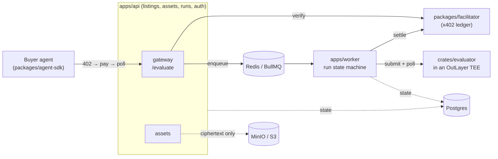

# SecureLambda

**Pay per run to test a model on data you never see.**

[](https://github.com/hafidabid/secure-lambda402-server-api/actions/workflows/ci.yml)


A hospital holds patient data it can't legally share. An AI company holds a model it won't hand over. SecureLambda lets the hospital seal the dataset, the AI company seal the model, and a Rust evaluator inside a hardware TEE score one against the other — releasing only rounded metrics. The buyer's agent pays per run over the x402 protocol on NEAR.

The seller never sees the model. The buyer never sees the dataset. Only `{ accuracy, auc, f1 }` ever leaves the enclave.

---

## How it fits together



Everything left of the TEE only ever touches **ciphertext**. Plaintext exists in exactly two places: the browser that encrypted it, and the enclave that scores it.

---

## Quick start

```bash
npm install
docker compose up -d postgres redis minio

npm run build --workspace=@securelambda/db
npm run prisma:migrate:deploy --workspace=@securelambda/db
npx ts-node ops/seed.ts

npm run build
npm run start --workspace=@securelambda/api      # terminal 1 — http://localhost:3000
npm run start --workspace=@securelambda/worker   # terminal 2

ops/preflight.sh                                 # sanity-check the result
```

**Run the tests:**

```bash
npm run test --workspaces --if-present   # 161 TypeScript tests (Jest)
cd crates/evaluator && cargo test        # 38 Rust tests, incl. cross-language crypto vectors
```

Several suites spin up real Postgres/Redis via Testcontainers rather than mocking — Docker needs to be running, same as CI.

---

## What's in here

| Path | What it does |
|---|---|
| `apps/api` | NestJS API — listings, assets, seller allow-list auth, the `/evaluate` gateway, run status (REST + SSE) |
| `apps/worker` | BullMQ consumer running the full run state machine: submit → poll → retry → settle |
| `crates/evaluator` | The Rust evaluator: decrypts, scores, rounds — what actually runs inside the TEE |
| `packages/schemas` | Shared zod contracts, error codes, and the run state machine — the one source of truth |
| `packages/crypto` | Envelope encryption (AES-256-GCM + X25519/HKDF), cross-checked against the Rust side |
| `packages/facilitator` | The x402 payment ledger (verify/settle), Redis-backed so the gateway and worker agree |
| `packages/agent-sdk` | A real buyer-agent client: handles the 402 → pay → poll loop |
| `packages/db` | Prisma schema + migrations |
| `ops/` | Seed script, pre-flight check, operator runbook |

---

<details>
<summary><strong>Trust tier — what this actually guarantees</strong></summary>

<br>

**Tier 1 (this build):** the evaluator's private key is generated once by the operator and the local copy is destroyed; the operator is trusted not to have kept one. That's an honest, stated limitation — not a claim of "100% private." Tier 2 (generating the key inside the enclave, never exported) is a deployment change, not a code change — the envelope scheme already supports it.

What *is* proven here: the seller's dataset and the buyer's model are never visible to the platform, only to the enclave; only rounded, rationed metrics ever leave it; and a wrapped key replayed against a different listing, role, or evaluator version fails to decrypt (verified with real Testcontainers, not just mocks).

</details>

<details>
<summary><strong>What's real vs. what's simulated</strong></summary>

<br>

**Proven live** against real services (`ops/live-e2e.sh`, 25 checks, output in `docs/pr-evidence/live-e2e-output.txt`):
- A paid run over HTTP: real sealed upload to **Cloudflare R2**, a real **NEAR testnet** payment, the real **Rust evaluator**, and a settlement transaction you can open in the explorer
- The **buyer** pays (in wNEAR, from the buyer's own balance); the relayer pays gas only
- Metrics recomputed independently in TypeScript match the evaluator's
- A forged payment is refused, and replaying a payment does not charge twice
- Login is by NEP-413 signature: a typed `x-account-id` is refused, and one account cannot read another's run

**Implemented and tested** (200+ tests, several against real Postgres/Redis): envelope encryption cross-checked between TypeScript and Rust, the full run state machine, the x402 quote → verify → settle flow, the buyer SDK.

**Login:** `POST /v1/auth/challenge` returns a single-use nonce; the caller signs it (NEP-413, no gas, no transaction) with a full-access key of their account and sends it to `POST /v1/auth/login`, which returns a bearer session (1 hour, stored hashed in Redis). The account id on every request comes from that session. The `x-account-id` header is ignored (`AUTH_MODE=signed`, the default); `AUTH_MODE=header` exists for local development only and the API refuses to start with it in production. The SDK does this for you: `createNearLogin(...)` is passed as the client's `headers`, and the CLI logs in with `NEAR_ACCOUNT_ID`/`NEAR_PRIVATE_KEY`. Only the buyer who paid can read a run, its receipt or its event stream.

**Still simulated or missing:**
- Login has no rate limit on `/auth/challenge` yet beyond the global per-IP limit; sessions cannot be listed or revoked other than by logout or expiry.
- **Enclave runs are on testnet only, and the TDX quote itself is not verified yet.** With `EVALUATOR_MODE=outlayer` the worker runs the evaluator in OutLayer's TEE through NEAR; the result and the executed wasm hash are read from the chain and the hash is checked before anything is charged. The Intel TDX attestation quote is not independently verified by this service (the `outlayer-verify` tool can check one offline). `EVALUATOR_MODE=local` still runs the same evaluator as a plain process; those runs are labelled `mode: "local"` and are never reported as attested.
- **Sepolia / USDC is not wired.** See "Payment path" below.
- Escrow/refund contracts, non-logistic-regression models, the dashboard, NEAR mainnet.

</details>

<details>
<summary><strong>Known limitations of this particular sandbox</strong></summary>

<br>

- `~/.cargo` and `~/.rustup` may be root-owned (a `sudo` rustup install). `ops/live-e2e.sh` works around the first by using a project-local `CARGO_HOME`. The `wasm32-wasip1` target install is still blocked in that case; native `cargo test` is unaffected.

</details>

---

## Payment path

Buyers pay in a NEP-141 token (wNEAR by default, `wrap.testnet` on testnet). Per `apps/api`'s gateway and `packages/facilitator`:

1. **Quote** — `POST /v1/listings/:id/evaluate` without payment → `402` with price, `payTo`, the token contract, a nonce, a 15-minute window.
2. **Sign** — the buyer SDK signs a NEP-366 *delegate action* that calls `ft_transfer`. It sends nothing to the chain. If the buyer holds only native NEAR, the SDK can wrap it into wNEAR first (`autoWrapNear`, 1:1).
3. **Verify** — retry with the signed payment in `X-Payment`. The facilitator checks the signed bytes against the quote, the signing key on-chain, the nonce, the expiry and the buyer's token balance. Nothing spent yet.
4. **Execute** — the run is queued; the worker runs the evaluator.
5. **Settle** — only after a successful, hash-verified result does the relayer submit the delegate. A failed run is never charged.

**Why a token and not native NEAR:** on NEAR, the deposit of any action inside a delegate is charged to the *relayer*, not the sender. A native `Transfer` would let buyers spend the platform's money. `ft_transfer` debits the buyer's balance inside the token contract; the relayer only pays gas. The first version of this build got this wrong, and the live test caught it.

**Seller onboarding:** a seller must register once on the token contract (`storage_deposit`, see `ensureRegisteredOnToken`), or payments to them are refused before any compute is spent.

**USDC:** any NEP-141 works by configuration (`PAYMENT_TOKEN_CONTRACT`). Sepolia USDC lives on a different chain and cannot be swapped into NEAR testnet tokens; supporting it means a second facilitator (EVM, EIP-3009), not a swap.

Build the evaluator for its real target with `cd crates/evaluator && cargo build --release --target wasm32-wasip1` — see `ops/runbook.md` for the key-generation and deployment steps.

---

**Status:** core backend works end to end against real NEAR testnet, Cloudflare R2 and the real Rust evaluator. The remaining gaps for a real deployment are the TEE client and secure login (see "What's real vs. what's simulated").

To reproduce the live run: put credentials in `./secret` (gitignored) and run `ops/live-e2e.sh`. See `ops/runbook.md`.
