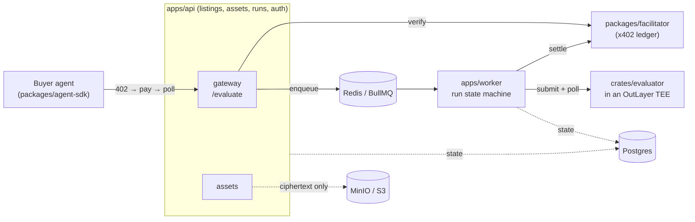

# SecureLambda

**Pay per run to test a model on data you never see.**

[](https://github.com/hafidabid/secure-lambda402-server-api/actions/workflows/ci.yml)


A hospital holds patient data it can't legally share. An AI company holds a model it won't hand over. SecureLambda lets the hospital seal the dataset, the AI company seal the model, and a Rust evaluator inside a hardware TEE score one against the other — releasing only rounded metrics. The buyer's agent pays per run over the x402 protocol on NEAR.

The seller never sees the model. The buyer never sees the dataset. Only `{ accuracy, auc, f1 }` ever leaves the enclave.

---

## How it fits together



Everything left of the TEE only ever touches **ciphertext**. Plaintext exists in exactly two places: the browser that encrypted it, and the enclave that scores it.

---

## Quick start

```bash
npm install
docker compose up -d postgres redis minio

npm run build --workspace=@securelambda/db
npm run prisma:migrate:deploy --workspace=@securelambda/db
npx ts-node ops/seed.ts

npm run build
npm run start --workspace=@securelambda/api      # terminal 1 — http://localhost:3000
npm run start --workspace=@securelambda/worker   # terminal 2

ops/preflight.sh                                 # sanity-check the result
```

**Run the tests:**

```bash
npm run test --workspaces --if-present   # 161 TypeScript tests (Jest)
cd crates/evaluator && cargo test        # 38 Rust tests, incl. cross-language crypto vectors
```

Several suites spin up real Postgres/Redis via Testcontainers rather than mocking — Docker needs to be running, same as CI.

---

## What's in here

| Path | What it does |
|---|---|
| `apps/api` | NestJS API — listings, assets, seller allow-list auth, the `/evaluate` gateway, run status (REST + SSE) |
| `apps/worker` | BullMQ consumer running the full run state machine: submit → poll → retry → settle |
| `crates/evaluator` | The Rust evaluator: decrypts, scores, rounds — what actually runs inside the TEE |
| `packages/schemas` | Shared zod contracts, error codes, and the run state machine — the one source of truth |
| `packages/crypto` | Envelope encryption (AES-256-GCM + X25519/HKDF), cross-checked against the Rust side |
| `packages/facilitator` | The x402 payment ledger (verify/settle), Redis-backed so the gateway and worker agree |
| `packages/agent-sdk` | A real buyer-agent client: handles the 402 → pay → poll loop |
| `packages/db` | Prisma schema + migrations |
| `ops/` | Seed script, pre-flight check, operator runbook |

---

<details>
<summary><strong>Trust tier — what this actually guarantees</strong></summary>

<br>

**Tier 1 (this build):** the evaluator's private key is generated once by the operator and the local copy is destroyed; the operator is trusted not to have kept one. That's an honest, stated limitation — not a claim of "100% private." Tier 2 (generating the key inside the enclave, never exported) is a deployment change, not a code change — the envelope scheme already supports it.

What *is* proven here: the seller's dataset and the buyer's model are never visible to the platform, only to the enclave; only rounded, rationed metrics ever leave it; and a wrapped key replayed against a different listing, role, or evaluator version fails to decrypt (verified with real Testcontainers, not just mocks).

</details>

<details>
<summary><strong>What's real vs. what's simulated in this environment</strong></summary>

<br>

**Implemented and tested** (199 passing tests — 161 TS, 38 Rust, several against real Postgres/Redis, not just mocks):
- Envelope encryption, cross-checked byte-for-byte between the TypeScript and Rust implementations
- The Rust evaluator — real scoring logic (clamped logistic regression, accuracy/F1/rank-based AUC), not a stub
- The full run state machine, including a genuine concurrent-duplicate-delivery race and a cross-process settlement test
- The x402 quote → verify → settle flow, with rate limits and budgets checked before any price is quoted
- The buyer-agent SDK, over real HTTP

**Designed for, but not live-wired** (this sandbox has no real NEAR/OutLayer credentials):
- Live NEAR RPC — payment verification runs against a `FacilitatorPort` interface; a real NEAR-backed implementation would satisfy the same interface
- Live OutLayer execution — the worker calls an `OutLayerClient` interface; this build ships a fault-injectable mock. The evaluator it would run is real and tested.
- Compiling the evaluator to its actual `wasm32-wasip1` target — `cargo test` passes on the native target; CI cross-compiles on every push with a clean toolchain

**Not in this build:** escrow/refund contracts, non-logistic-regression models, EVM, NEP-413 wallet sign-in (uses a seller allow-list instead), the Next.js dashboard, live NEAR mainnet.

</details>

<details>
<summary><strong>Known limitations of this particular sandbox</strong></summary>

<br>

- MinIO's image isn't pullable here, so asset-storage tests use an in-memory stand-in. The real `StorageService`/`S3StorageClient` code is written against the real API.
- `~/.rustup` is root-owned in this environment, blocking the `wasm32-wasip1` target install. `cargo test` on the native target is unaffected and fully passing.

</details>

---

## Payment path

NEAR native is the default asset; USDC is configurable but untested (no `storage_deposit` flow here). Per `apps/api`'s gateway and `packages/facilitator`:

1. **Quote** — `POST /v1/listings/:id/evaluate` without payment → `402` with price, `payTo`, a nonce, a 15-minute window.
2. **Verify** — retry with a signed payment in `X-Payment`; checked for signature, amount, expiry, nonce reuse. Nothing spent yet.
3. **Execute** — the run is queued; the worker submits it to the TEE and polls.
4. **Settle** — only after a successful, hash-verified result does money move. A failed run is never charged.

Build the evaluator for its real target with `cd crates/evaluator && cargo build --release --target wasm32-wasip1` — see `ops/runbook.md` for the key-generation and deployment steps.

---

**Status:** core backend implemented and tested end to end against sandboxed chain/TEE seams. Wiring in real NEAR + OutLayer credentials is the remaining step to a live deployment — both were built as swappable interfaces for exactly that.
