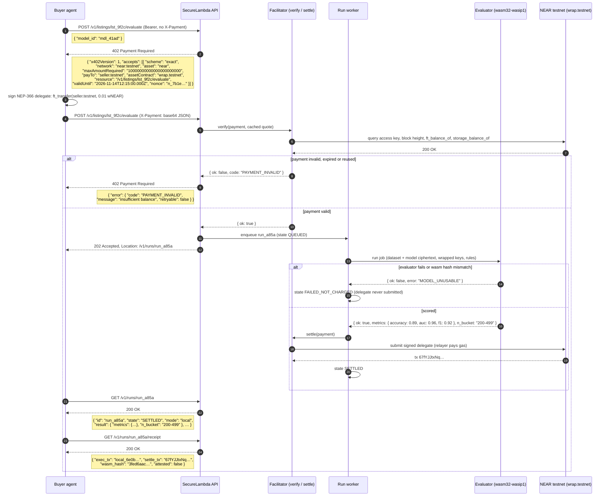
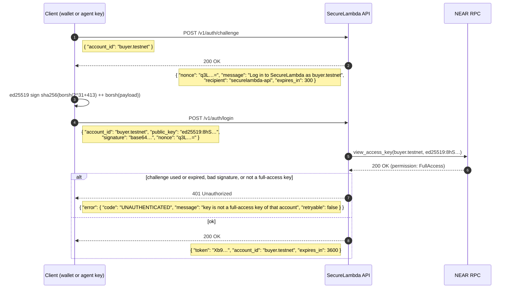

# Developer docs for SecureLambda: plan

Status: answers received 2026-11-14 and recorded below. No page code is written yet.

## Decisions

- **MCP:** build a stdio MCP server in its own PR (Detail D), then document it.
- **TEE:** document OutLayer (Intel TDX) as the evaluator. Jason says the OutLayer client is on `develop` and will be live by submission. That branch is not on `origin` (checked with `git ls-remote`), so the attestation details have not been read. Before the how-it-works page and the run and receipt examples ship, check them against that code: `mode: "enclave"`, `attested: true`, the real `exec_tx` format, and how the quote is verified. Audit row 9 changes with it.
- **Format:** in-app `/docs` with MDX (Detail C).
- **Audience:** developers first. Build order and nav: quickstart → reference → guides → agents and MCP → how-it-works.

## 1. Overview

The docs move from the two GitHub markdown files to an in-app section at `/docs` in `apps/dashboard`, built with the landing page's instrument tokens. There are four parts:

1. **Integration guides** for the dashboard and the API: sell a dataset, test a model, log in with NEP-413, and what the browser encrypts.
2. **API reference** built from `packages/schemas`. A CI test fails when a route exists in the API but not in the reference, or the other way round.
3. **Pay per run (x402) and MCP**: how an agent pays, then how to connect from Claude Code, Codex, Cursor or your own code. What goes here depends on the MCP decision (open question 1).
4. **How it works**: the technical story for engineers and judges, with sequence diagrams and a short "what is real today" box.

Why the current docs are not presentable, in short:

- **They are wrong in places.** Nine claims contradict the code (see Detail A). Examples: a "pause" step that has no endpoint, a `PAYMENT_REJECTED` state that is never written, and a 409 on model upload that the API never returns.
- **The audiences are mixed.** One guide serves people using the dashboard, agent developers and the team building the frontend (§10). None of them gets a complete path.
- **The reference is not usable.** Payloads use `{...}` and `"..."`. There are no field types or limits, no curl examples, and no per-endpoint headers or auth errors. The full error list lives in the *guide*, and the reference points there.
- **The code samples cannot be run.** They import `@securelambda/agent-sdk` and `@securelambda/crypto`, which are `"private": true` workspace packages and are not on npm. `sealFile` takes a Node `Buffer` and uses `node:crypto`, so it does not work in a browser.
- **Three hand-kept copies.** HTML is the source (`build.sh`), markdown and PDF are derived from it, and nothing checks any of them against the code.
- **The story disagrees with itself.** The README hero and the landing page say "inside a hardware TEE". The guide and the README's own "What's real" say `mode: "local"` and `attested: false`. The code agrees with the guide: there is no OutLayer client (`apps/worker/src/main.ts:37-40`).

## 2. Data model

No database changes. Additions to `packages/schemas` so the reference can be built from it:

- `api-routes.ts`: one entry per route, holding method, path, auth level, request schema, response schemas by status, error codes, and one checked example.
- New zod schemas for shapes that today exist only as TS interfaces or inline: auth challenge, login and session (the rework branch already adds `auth.ts`, so reuse that), `ApiErrorBodySchema`, `SellerRunSummarySchema`, `HealthSchema`, `UploadModelResponseSchema` (also on the rework branch).

## 3. APIs changed

None. The docs describe the API as it behaves today. Where the behaviour is a bug (Detail A, rows 3, 4 and 9), the docs record it as current behaviour, and each one is proposed as a separate fix.

## 4. APIs added

None, unless you choose to build the MCP server (open question 1). Its tool surface is in Detail D.

## 5. Old vs new flow

| | Old | New |
|---|---|---|
| Where | GitHub `docs/api/*.md`, plus HTML and PDF copies | `/docs/*` in the dashboard, same look as the landing page |
| Source of truth | Hand-written HTML | MDX for prose; reference pages render `api-routes.ts` and zod |
| Drift check | None | CI: the route set equals the registry, every example parses with its schema, TS samples typecheck |
| Landing footer | Links to GitHub markdown | Links to `/docs/guides` and `/docs/reference` (a two-line change in `instrument/data.ts`, left to the landing owner) |
| Old files | `docs/api/*.{md,html,pdf}`, `build.sh` | Replaced by short stubs that link to `/docs`; deleted only after you approve |

## 6. Third-party APIs used

- **NEAR testnet RPC** (`test.rpc.fastnear.com`): only in samples, for wallet signing and wNEAR wrapping.
- **Docs tooling**, all build-time or lazy-loaded: `@next/mdx`, `shiki` (syntax highlighting in a server component), `mermaid` (client, loaded only on pages that have diagrams), `zod-to-json-schema` (field tables).

## 7. UI changes

A new `/docs` section with its own layout: left nav, content column, on-page table of contents, and code blocks with copy buttons and tabs (curl / TypeScript / Python where useful). It uses the instrument tokens: panel background, Barlow headings, Barlow Condensed engraved section labels, Azeret Mono for code and hashes, and signal orange once per view for the primary link.

Pages:

| Route | For | Content |
|---|---|---|
| `/docs` | Everyone | One-paragraph product summary, three paths (use the dashboard / integrate the API / pay from an agent), and a status box saying what is real today |
| `/docs/quickstart` | Developers | Five minutes, curl first: get the evaluator key → log in → list listings → upload a model → evaluate (402 → pay → poll) |
| `/docs/guides/sell` | Data owners | Dashboard walkthrough, then the same steps over the API. Covers the allow-list and wNEAR `storage_deposit` setup |
| `/docs/guides/buy` | Model owners | Dashboard walkthrough, then the API path. Covers the model JSON contract (feature order, weight limits) and reading results |
| `/docs/guides/login` | Developers | NEP-413 three ways: browser wallet `signMessage`, the SDK, any language (byte layout) |
| `/docs/guides/encryption` | Developers | What is sealed and where: the envelope, AAD binding, `ct_sha256`, and sealing a file yourself |
| `/docs/agents` | Agent builders | The x402 exchange step by step, with real headers and bodies; the wNEAR rule and why; replay and expiry |
| `/docs/agents/mcp` | Agent builders | Depends on open question 1 |
| `/docs/reference` | Developers | Conventions: base URL, auth levels, amounts, errors, pagination, CORS, limits |
| `/docs/reference/{auth,listings,assets,evaluate,runs,health}` | Developers | Generated. One block per endpoint: method, path, auth, headers, field table, request and response JSON, status codes, errors, and a curl example |
| `/docs/reference/errors` | Developers | Generated from `ERROR_CODE_INFO`, with what to do for each code |
| `/docs/reference/run-states` | Developers | Generated from `RUN_TRANSITIONS`, including which states a client can actually observe |
| `/docs/how-it-works` | Engineers, judges | Architecture; envelope encryption to the evaluator key; the evaluator and output rationing (rounding, row buckets, `min_rows`, `min_class_count`); trust tiers and attestation, current vs designed; verify-then-settle and why it uses wNEAR; the run state machine; threat model and what is not proven; evidence (the live run, settle tx `67fYJJ…`) |

Search is left out of v1: about 14 pages and a sidebar are enough.

## 8. Risks

- **Overclaiming the TEE.** Judges will read the code. If the technical story says "inside Intel TDX" while `mode` is `local`, the project looks dishonest. My recommendation is in open question 2.
- **Collisions with the dashboard rework** (`claude/dashboard-rework-3bfb5a`, uncommitted). It changes `packages/schemas` (new `auth.ts`), ports `@securelambda/crypto` to `Uint8Array`, and rewrites `AppHeader`. The docs' sealing samples and auth schemas depend on that work. I will build the docs on top of it after it lands, and use a separate docs header so `AppHeader` is not touched.
- **Unusable samples.** Outside developers cannot `npm install` the SDK or the crypto package. The guides lead with curl and plain HTTP, and present the SDK as "in this repo". Publishing the packages is a separate decision.
- **Bugs the docs expose** (Detail A, rows 3, 4 and 9). They are documented as they behave today and filed as follow-ups, not fixed inside the docs work.
- **Next 16 + MDX.** Under Turbopack, remark and rehype plugins accept only serializable options. Highlighting runs in a server component (shiki) to avoid that limit.

## 9. Diagram

The same diagrams will appear on `/docs/agents` and `/docs/how-it-works`.

### Pay per run (x402 on NEAR)



### Login (NEP-413)



### Seal and upload (browser)

```mermaid
sequenceDiagram
    autonumber
    participant BR as Browser (dashboard)
    participant GW as SecureLambda API
    participant S3 as Object storage (R2)

    BR->>GW: GET /v1/evaluator
    GW-->>BR: 200 OK
    Note left of GW: { "version": "1.0.0", "public_key": "ICkMWdD7…=",<br/>"wasm_hash": "3fed6aac…", "trust_tier": 1 }
    BR->>BR: K_file = random 32 B; blob = AES-256-GCM(K_file, csv)
    BR->>BR: wrap K_file to X25519+HKDF(public_key), AAD = securelambda/v1||lst_9f2c||dataset||1.0.0||sha256(blob)
    BR->>GW: POST /v1/listings/lst_9f2c/dataset (multipart: ciphertext, wrapped_key)
    alt envelope malformed / file > 1 MiB / not owner
        GW-->>BR: 422 ENVELOPE_INVALID / 413 ASSET_TOO_LARGE / 403 FORBIDDEN
    else stored
        GW->>S3: PUT ast_…  (ciphertext only)
        GW-->>BR: 201 Created
        Note left of GW: { "asset_id": "ast_5c0e…" }
    end
```

## Open questions

1. **MCP.** No MCP server exists in this repo or on any remote branch, yet the landing page already shows Claude Code, Codex and Cursor as clients. Choices:
   - (a) Document it as a planned spec, labelled "not shipped".
   - (b) Document only the SDK and HTTP paths.
   - (c) Build a small stdio MCP server in a separate PR, then document it.

   My recommendation is (c). The tool surface is in Detail D, and it reuses the agent SDK, so it is small. If there is no time, (b), and the landing page should drop the client logos.
2. **TEE wording.** The code has no OutLayer client, and every run is `mode: "local"`, `attested: false`. My recommendation: describe the enclave design as designed, put a fixed "today: local evaluator, not attested" status beside every enclave claim, and show the `OutLayerClient` seam as the next step. If an OutLayer client exists somewhere I haven't seen, tell me where.
3. **Format.** My recommendation is in-app MDX at `/docs` (Detail C). The alternative is Fumadocs or Mintlify.
4. **Audience priority.** Who comes first: hackathon judges (how-it-works and agents first) or integrating developers (quickstart and reference first)?

---

## Detail

### A. Audit: current docs vs code

| # | Doc claim | Code reality | Fix in docs |
|---|---|---|---|
| 1 | "To edit a published listing you must pause it first" (`docs/api/integration-guide.md:97`); PATCH works on "draft or paused" (`endpoint-reference.md:169`) | No pause or unpause endpoint exists. PATCH allows `draft` only (`apps/api/src/listings/listings.service.ts:110`). A listing becomes `paused` only when the worker sees a wasm hash mismatch (`apps/worker/src/run-processor.ts:133`) | Say that published listings cannot be edited today |
| 2 | Model upload errors include `409 LISTING_NOT_PUBLISHED` (`endpoint-reference.md:253`) | `uploadModel` checks only that the listing exists (`apps/api/src/assets/assets.service.ts:125-131`), so a model can be uploaded to a draft | Remove the 409; evaluate is where the listing is rejected |
| 3 | "Every error has the same shape" (`integration-guide.md:177`) | Run 404s throw Nest's `NotFoundException` (`apps/api/src/runs/runs.service.ts:40,57`), and the filter passes its body through unchanged (`apps/api/src/common/api-error.filter.ts:22-29`): `{ "statusCode": 404, "message": "Run not found: run_x", "error": "Not Found" }`. `/readyz` 503 has the same shape | Document both shapes; propose a fix |
| 4 | Evaluate returns 402, 200 with a result, or 202 (`endpoint-reference.md:276-280`) | A run that fails within the 1.5 s inline wait returns **HTTP 200** with an error body `{ "error": { "code": "RUN_FAILED_NOT_CHARGED", … } }` (`apps/api/src/gateway/gateway.service.ts:254`, `packages/schemas/src/error-codes.ts:59`). The SDK then throws a zod parse error (`packages/agent-sdk/src/client.ts:108`) | Document it; propose fixing both the API and the SDK |
| 5 | Evaluate errors list (`endpoint-reference.md:282`) | Missing: `404 MODEL_NOT_FOUND`, `409 MODEL_BOUND_TO_OTHER_LISTING`, `422 VALIDATION_FAILED` (`gateway.service.ts:55-58`, `gateway.controller.ts:25`), and `429 RATE_LIMITED` when `runs_per_day` is exceeded (`gateway.service.ts:118`). The per-IP limit also counts the unpaid quote call | Generated from the registry |
| 6 | Run states include `REQUESTED` and `PAYMENT_REJECTED` (`integration-guide.md:124,167-171`) | Runs are created at `QUEUED` (`gateway.service.ts:185`). A rejected payment is a 402 with no run (`gateway.service.ts:86-89`), so `REQUESTED`, `PAYMENT_VERIFIED` and `PAYMENT_REJECTED` are never observable | The run-states page marks which states a client can observe |
| 7 | `NOT_OWNER` (`integration-guide.md:182`) | Never thrown. Owner checks throw `FORBIDDEN` (`listings.service.ts:106,231`, `assets.service.ts:75`) | Error page lists only codes that can be emitted, plus a "reserved" group |
| 8 | `GET /v1/listings/:id` returns "the listing" (`endpoint-reference.md:233`) | Two shapes: a published listing returns the catalog item (no `seller_id`, `rules`, `dataset_asset_id`); the owner's own draft returns the full `Listing` (`listings.service.ts:146-153`) | Show both responses |
| 9 | `mode` is `local` today (`integration-guide.md:173`) | A run is created with `mode: "enclave"` (`gateway.service.ts:188`) and only changes to `local` at `SUBMITTED` (`run-processor.ts:94`), so polling a `QUEUED` run shows `"enclave"` | Document it; propose a fix |
| 10 | Uploads return a JSON body, status not stated | `201 Created` (no `@HttpCode`, `assets.controller.ts:35,59`; confirmed in `docs/pr-evidence/live-e2e-output.txt`). A missing `ciphertext` part crashes into `500 INTERNAL` (`assets.controller.ts:52`) | State 201; note the 500 |
| 11 | SDK and crypto imports in samples (`integration-guide.md:56,84`) | `"private": true`, not on npm (`packages/agent-sdk/package.json`); `sealFile(Buffer, Buffer)` uses `node:crypto` (`packages/crypto/src/envelope-flow.ts:22`) | curl and HTTP first; SDK marked "in this repo"; browser sealing documented after the rework's noble port lands |
| 12 | `/v1/seller/runs` placed under the allow-listed seller steps (`integration-guide.md:101-103`) | Login only, no allow-list (`apps/api/src/runs/runs.controller.ts:88`) | Correct auth level |
| 13 | Two public-key formats, not explained | Login `public_key` is `ed25519:<base58>`; payment `payerPublicKey` is raw base64 (`packages/facilitator/src/near-facilitator.ts`, comparison with `Buffer.from(…, "base64")`) | Field tables state the formats |

Structure problems: the guide and the reference duplicate each other and point at each other (`endpoint-reference.md:45`). The guide's §10 is aimed at the frontend team. The dashboard is not covered at all. The how-it-works material is hidden in collapsed sections of the README.

One more point for the technical story: a result is visible through `GET /v1/runs/:id` from `RESULT_READY`, before settlement (`runs.service.ts` maps `resultJson` in every state). If settlement never succeeds, for example because the buyer drained their wNEAR between verify and settle, the buyer keeps the result unpaid. The operator carries that risk, and the docs should say so.

### B. How the reference stays in sync

1. `packages/schemas/src/api-routes.ts` is the registry. Each entry: `{ method, path, auth: "none" | "optional" | "login" | "seller", request?: { body?, query?, multipart? }, responses: { [status]: ZodSchema }, errors: ErrorCode[], example: { request?, response } }`.
2. Drift test in `apps/api`: boot the Nest app, list the Express routes, and assert that the set of `METHOD path` pairs equals the registry. Adding a route without documenting it fails CI.
3. Example test: every `example` is parsed with its schema, so example JSON cannot go stale.
4. The reference pages render field tables from `zod-to-json-schema` (zod 3), the error page from `ERROR_CODE_INFO`, and the state diagram from `RUN_TRANSITIONS`.
5. What the registry does not prove: that a route really emits the error codes listed for it. Rows 3–5 of the audit show those lists drift. A cheap partial check: grep each service for `new ApiError("X"` and fail when a thrown code is missing from its route's list. I'd skip that in v1.

Code samples:

- TypeScript samples are real files under `apps/dashboard/src/docs/samples/`, read at render time by a server component, and typechecked in CI against the workspace packages.
- curl samples are generated from registry examples.
- The quickstart sample also runs in the existing API integration suite (Testcontainers, sandbox facilitator), so the copy-paste path is exercised in CI.

### C. Delivery format

**Context.** About 14 pages. The look must match the landing page, and the site deploys with the dashboard.

**Decision.** In-app `/docs` on `@next/mdx`, with a small custom layout, shiki in a server component, and lazy-loaded mermaid.

**Consequences.**

- No second deploy, and the tokens and fonts are shared.
- It costs a sidebar, a table of contents, code tabs and a copy button: roughly 300 lines.
- Fumadocs would give search and layout for free, but it brings its own design system to fight and its Next 16.4 compatibility is unverified. Mintlify or Docusaurus mean another host, another look, and nothing in-repo to check the reference against.

### D. MCP server sketch (only if option c)

`packages/mcp-server`, a stdio server that runs on the user's machine. The buyer's NEAR key stays local and is read from `NEAR_ACCOUNT_ID` and `NEAR_PRIVATE_KEY`. It wraps `BuyerAgentClient`, `createNearLogin` and `createNearPaymentSigner`.

| Tool | Input | Output |
|---|---|---|
| `list_listings` | `{ q?, limit?, cursor? }` | Catalog items |
| `get_listing` | `{ listing_id }` | Schema, sample rows, price |
| `upload_model` | `{ listing_id, model: { features, weights, bias } }` | `{ model_id }`. Validates against the listing schema, then seals locally |
| `quote_run` | `{ listing_id, model_id }` | The 402 quote (price, payTo, expiry), without paying |
| `run_evaluation` | `{ listing_id, model_id, max_amount }` | Result and receipt. Refuses when the quote is above `max_amount` |
| `get_run` | `{ run_id }` | Run state, result, receipt |

`max_amount` is the spending guard: the agent states the most it will pay, and the server never signs a quote above it. Setup snippets for Claude Code (`claude mcp add`), Codex (`config.toml`) and Cursor (`mcp.json`) all point at `npx tsx packages/mcp-server/src/index.ts` until the package is published.

### E. Build order once approved

1. ~~Wait for the dashboard rework to merge~~ Done: merged to main, and this branch is on `origin/main`.
2. Schemas: add the missing zod shapes and `api-routes.ts`, with the drift and example tests.
3. Docs shell: layout, nav, MDX, code block, diagram component. Done (uncommitted).
4. Reference pages (generated), then errors and run states.
5. Guides, quickstart, agents and how-it-works.
6. MCP page, depending on question 1.
7. Footer links (landing owner), then stubs in `docs/api/`, and deletion of the old HTML and PDF after your OK.

Follow-ups outside the docs: audit rows 3, 4 and 9 (API and SDK fixes); publishing the SDK and crypto packages; adding a pause/unpause endpoint, or dropping `paused` from the docs.
