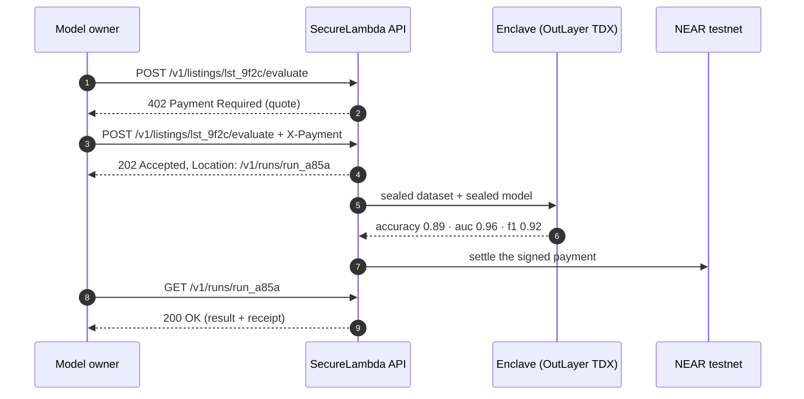

export const metadata = {
  title: "Docs · SecureLambda",
  description: "Test an AI model on a dataset you can't see, and pay per run on NEAR.",
};

# SecureLambda docs

Test an AI model on a dataset you can't see. Both files are encrypted in the browser, the model is scored inside an Intel TDX enclave on OutLayer, and only three rounded numbers come out. Each run is paid on NEAR, by a wallet or by an AI agent over x402.

## How a run works



The buyer signs the payment first, but it is only sent to the chain after a successful run. A run that fails is never charged.

## Three ways in

| You want to | Start with |
|---|---|
| List a dataset or test a model by hand | The dashboard: [catalog](/listings) or [sell a dataset](/sell/new) |
| Call the API from your own code | The base URL `https://secure-lambda-api.projectdeadwood.my.id`, all routes under `/v1` |
| Let an AI agent pay per run | x402 on NEAR: a `402` quote, then a signed `X-Payment` retry |

## Try it

The evaluator's public key is public. Everything you upload is encrypted to it.

```bash
curl https://secure-lambda-api.projectdeadwood.my.id/v1/evaluator
```

```json
{
  "version": "1.0.0",
  "project_id": "securelambda/local-evaluator",
  "wasm_hash": "3fed6aac…",
  "public_key": "ICkMWdD7…=",
  "trust_tier": 1
}
```

> A real paid run settled on NEAR testnet in transaction [`67fYJJtxNqFM33UeXMWfAvP5ELkp4vDZWnWfQMCJUkXj`](https://testnet.nearblocks.io/txns/67fYJJtxNqFM33UeXMWfAvP5ELkp4vDZWnWfQMCJUkXj). The seller received exactly the price, and the relayer paid only the gas.
