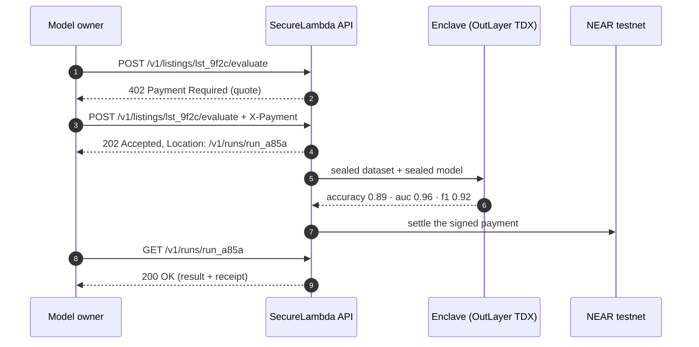

export const metadata = {
  title: "Docs · SecureLambda",
  description: "Test an AI model on a dataset you can't see, and pay per run on NEAR.",
};

# SecureLambda docs

Test an AI model on a dataset you can't see. Both files are encrypted in the browser, the model is scored inside an Intel TDX enclave on OutLayer, and only three rounded numbers come out. Each run is paid on NEAR, by a wallet or by an AI agent over x402.

## Test it in 5 minutes

Everything runs on NEAR testnet. Nothing costs real money.

**1. Get a funded testnet account.** Create an account ending in `.testnet` ([how](https://docs.near.org/getting-started/create-account)), then add testnet NEAR from the [faucet](https://near-faucet.io/). With the NEAR CLI, one command does both: `near create-account <you>.testnet --useFaucet`.

**2. Turn some NEAR into wNEAR.** Runs are paid in wNEAR (`wrap.testnet`), which is NEAR wrapped 1:1 as a token. Register once, then wrap a little more than the price of a run:

```bash
near contract call-function as-transaction wrap.testnet storage_deposit json-args '{"registration_only":true}' prepaid-gas '30 Tgas' attached-deposit '0.00125 NEAR' sign-as <you>.testnet network-config testnet sign-with-keychain send
near contract call-function as-transaction wrap.testnet near_deposit json-args '{}' prepaid-gas '30 Tgas' attached-deposit '3 NEAR' sign-as <you>.testnet network-config testnet sign-with-keychain send
```

**3. Download the sample kit.** Synthetic data, not real patients.

| File | Use it as |
|---|---|
| [glucose-model.json](/samples/glucose/glucose-model.json) | Buyer: the model to test |
| [glucose.csv](/samples/glucose/glucose.csv) | Seller: the dataset to list (240 rows) |
| [glucose-schema.json](/samples/glucose/glucose-schema.json) | Seller: the columns, for reference |

**4. Test the model as a buyer.** Open **Glucose demo** in the [catalog](/listings), sign in with your wallet, add `glucose-model.json` and choose **Run once**. A successful run shows accuracy `0.89`, AUC `0.96` and F1 `0.92`. The receipt links the payment and the enclave run on the NEAR explorer, and checks that the evaluator that ran is the one the listing pinned.

**5. List a dataset as a seller.** Open [sell a dataset](/sell/new), give it any name, add `glucose.csv` and set the label column to `y`. Then buy a run on your own listing with the same model.

## How a run works



The buyer signs the payment first, but it is only sent to the chain after a successful run. A run that fails is never charged.

## Three ways in

| You want to | Start with |
|---|---|
| List a dataset or test a model by hand | The dashboard: [catalog](/listings) or [sell a dataset](/sell/new) |
| Call the API from your own code | The base URL `https://secure-lambda-api.projectdeadwood.my.id`, all routes under `/v1` |
| Let an AI agent pay per run | x402 on NEAR: a `402` quote, then a signed `X-Payment` retry |

## Try it

The evaluator's public key is public. Everything you upload is encrypted to it.

```bash
curl https://secure-lambda-api.projectdeadwood.my.id/v1/evaluator
```

```json
{
  "version": "1.0.0",
  "project_id": "hafidbuild.testnet/secure-lambda-evaluator",
  "wasm_hash": "66cb5fc5…",
  "public_key": "NoEfZL76…=",
  "trust_tier": 1
}
```

> A real paid run settled on NEAR testnet in transaction [`67fYJJtxNqFM33UeXMWfAvP5ELkp4vDZWnWfQMCJUkXj`](https://testnet.nearblocks.io/txns/67fYJJtxNqFM33UeXMWfAvP5ELkp4vDZWnWfQMCJUkXj). The seller received exactly the price, and the relayer paid only the gas.
