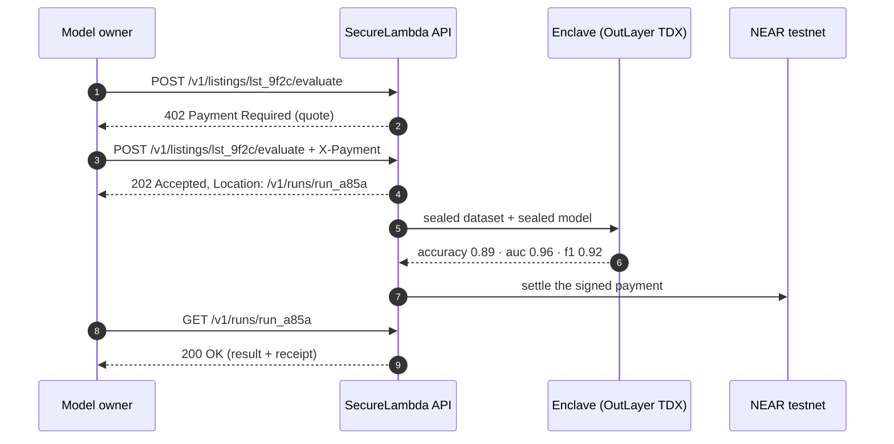

export const metadata = {
  title: "Docs · SecureLambda",
  description: "Test an AI model on a dataset you can't see, and pay per run on NEAR.",
};

# SecureLambda docs

Test an AI model on a dataset you can't see. Both files are encrypted in the browser, the model is scored inside an Intel TDX enclave on OutLayer, and only three rounded numbers come out. Each run is paid on NEAR, by a wallet or by an AI agent over x402.

## Test it in 5 minutes

Everything runs on NEAR testnet. Nothing costs real money.

**1. Get a wallet and testnet NEAR.** Install a NEAR wallet browser extension such as [Meteor Wallet](https://meteorwallet.app/), switch it to testnet and create an account ending in `.testnet`. Add testnet NEAR from the [faucet](https://near-faucet.io/); 0.1 NEAR is plenty, since a run costs 0.015 to 0.05 NEAR.

**2. Nothing to wrap by hand.** Runs are paid in wNEAR (`wrap.testnet`), NEAR wrapped 1:1 as a token. If your wallet holds only NEAR, **Run once** asks it to wrap the price first, in the same approval that registers you on the token.

**3. Download a model.** Each one matches a listing in the catalog. Synthetic data, not real patients.

| Listing | Model | Expected score |
|---|---|---|
| Diabetes risk, Hospital A | [diabetes-model.json](/samples/models/diabetes-model.json) | accuracy 0.88 · AUC 0.94 · F1 0.83 |
| Sepsis early warning, ICU cohort | [sepsis-model.json](/samples/models/sepsis-model.json) | accuracy 0.92 · AUC 0.96 · F1 0.78 |
| Diabetic retinopathy screening | [retinopathy-model.json](/samples/models/retinopathy-model.json) | accuracy 0.83 · AUC 0.91 · F1 0.70 |
| Heart failure readmission | [heart-model.json](/samples/models/heart-model.json) | accuracy 0.85 · AUC 0.93 · F1 0.75 |
| COPD 30-day readmission | [copd-model.json](/samples/models/copd-model.json) | accuracy 0.82 · AUC 0.92 · F1 0.73 |

**4. Test the model as a buyer.** Open **Diabetes risk, Hospital A** in the [catalog](/listings), sign in with your wallet, add `diabetes-model.json` and choose **Run once**. The run takes 1 to 2 minutes in the enclave and costs 0.02 NEAR. The receipt links the payment and the enclave run on the NEAR explorer, and checks that the evaluator that ran is the one the listing pinned.

**5. List a dataset as a seller.** Open [sell a dataset](/sell/new), give it any name, add [glucose.csv](/samples/glucose/glucose.csv) and set the label column to `y`. Then test [glucose-model.json](/samples/glucose/glucose-model.json) on your own listing; it scores accuracy 0.89, AUC 0.96, F1 0.92.

## Let Claude pay for runs

SecureLambda ships an MCP server, so Claude Code, Claude Desktop or Codex can browse listings, quote a run and pay for it on your behalf. Claude makes its own wallet; you fund it with a plain transfer and no private key goes into any config file.

**1. Add it to your client.** It runs with `npx`, so there is nothing to install or build; you need Node.js 20 or later. The two caps are in yoctoNEAR: `50000000000000000000000` is 0.05 NEAR per run, `100000000000000000000000` is 0.1 NEAR for the session.

Claude Code:

```bash
claude mcp add --scope user --env SECURELAMBDA_MAX_PER_RUN=50000000000000000000000 --env SECURELAMBDA_SESSION_BUDGET=100000000000000000000000 --transport stdio securelambda -- npx -y @securelambda/mcp-server
```

Claude Desktop, in `claude_desktop_config.json` (then restart the app):

```json
{
  "mcpServers": {
    "securelambda": {
      "command": "npx",
      "args": ["-y", "@securelambda/mcp-server"],
      "env": {
        "SECURELAMBDA_MAX_PER_RUN": "50000000000000000000000",
        "SECURELAMBDA_SESSION_BUDGET": "100000000000000000000000"
      }
    }
  }
}
```

Codex, in `~/.codex/config.toml`:

```toml
[mcp_servers.securelambda]
command = "npx"
args = ["-y", "@securelambda/mcp-server"]
tool_timeout_sec = 240

[mcp_servers.securelambda.env]
SECURELAMBDA_MAX_PER_RUN = "50000000000000000000000"
SECURELAMBDA_SESSION_BUDGET = "100000000000000000000000"
```

**2. Connect Claude's wallet.** Ask Claude: *"Connect a SecureLambda agent wallet with 0.1 NEAR."* It generates a key on your computer and gives you a link. Open it, connect your wallet and send the amount; the page shows each step until the transfer lands. Claude can spend at most what you send, and nothing in your own account.

**3. Ask for a run.** Upload your model on the dashboard first (the MCP server does not upload models), then ask: *"Test model `mdl_…` on Diabetes risk, Hospital A, pay at most 0.05 NEAR."* Claude quotes the run, wraps NEAR into wNEAR if needed, pays, and returns the metrics and the receipt.

## How a run works



The buyer signs the payment first, but it is only sent to the chain after a successful run. A run that fails is never charged.

## Three ways in

| You want to | Start with |
|---|---|
| List a dataset or test a model by hand | The dashboard: [catalog](/listings) or [sell a dataset](/sell/new) |
| Call the API from your own code | The base URL `https://secure-lambda-api.projectdeadwood.my.id`, all routes under `/v1` |
| Let an AI agent pay per run | x402 on NEAR: a `402` quote, then a signed `X-Payment` retry |

## Try it

The evaluator's public key is public. Everything you upload is encrypted to it.

```bash
curl https://secure-lambda-api.projectdeadwood.my.id/v1/evaluator
```

```json
{
  "version": "1.0.0",
  "project_id": "hafidbuild.testnet/secure-lambda-evaluator",
  "wasm_hash": "66cb5fc5…",
  "public_key": "NoEfZL76…=",
  "trust_tier": 1
}
```

> A real paid run settled on NEAR testnet in transaction [`67fYJJtxNqFM33UeXMWfAvP5ELkp4vDZWnWfQMCJUkXj`](https://testnet.nearblocks.io/txns/67fYJJtxNqFM33UeXMWfAvP5ELkp4vDZWnWfQMCJUkXj). The seller received exactly the price, and the relayer paid only the gas.
